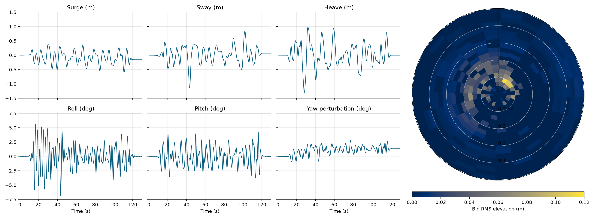

# Topwater

Topwater runs a boat in an observed directional sea, reconstructs the total water
surface, and renders the saved result. Capytaine supplies linear hydrodynamic
responses; the native Python solver computes excitation and six-degree-of-freedom
motion. The default workflow requires no MATLAB or Simulink.

## Quick start

Install with `uv sync --locked` as described in [setup](docs/setup.md). Then run:

```powershell
uv run topwater boat examples/simple-boat-native --length 7.3152 --beam 2.7432 --deadrise 20 --mass 2500
uv run topwater sea examples/simple-boat-native --record ndbc-46086-20231223T0040Z --seed 42
uv run topwater solve examples/simple-boat-native --dwell 100 --rest 10 --ramp 5
uv run topwater render examples/simple-boat-native
```

The example has a 100 s dwell, 5 s ramps and 10 s rests: 130 s total. Native is
the default backend. `--solver=wecsim` selects the optional MATLAB reference
backend. Rendering an existing result does not invoke a solver.

Private models can supply forces, torques, continuous device dynamics and
sampled feedback through the [external-model Python interface](docs/native.md).
Gyro control code belongs in an independently installed package.

Native reconstruction automatically uses a supported GPU when the optional
GPU package and driver are available. Install with `uv sync --extra gpu` and
run with `uv run --extra gpu topwater solve ...`. Use `--device cpu` or
`--device gpu` to choose explicitly. See [GPU setup and selection](docs/gpu.md).
Both devices use one reconstruction pipeline with shared caching, batching,
and Fourier preparation; CPU execution uses compiled potential-only kernels.

The [native example](examples/simple-boat-native/) contains the boat and sea inputs,
motion/surface archive, motion and spectrum plot, video and four command logs.
Its boat is a 24 ft by 9 ft open V-hull with total mass 2,500 kg. The sea is the
NDBC 46086 observation at 2023-12-23 00:40 UTC, realized with seed 42.



## Documentation

- [Setup](docs/setup.md): dependencies, optional MATLAB and local development.
- [Native solver](docs/native.md): dynamics, reference comparison and external models.
- [GPU reconstruction](docs/gpu.md): installation, device selection and supported configurations.
- [Workflow](docs/workflow.md): boat and sea generation, solve, render and outputs.
- [File formats](docs/formats.md): numeric arrays, units and coordinate frames.
- [Model assumptions](docs/model.md): physical method and practical limitations.
- [Performance](docs/performance.md): simple-boat profiles, speedups and remaining opportunities.

Physical validity is left to user interpretation of the documented assumptions,
limitations and results. There is no automated qualification or CI merge gate.
Old research, native-solver experiments and project bookkeeping are preserved in
committed Git history; the active tree contains the working workflow.

The [WEC-Sim reference example](examples/simple-boat-wecsim/) uses identical inputs
and keeps its historical MATLAB-generated results separately.

Source ownership follows the CLI: `topwater/boat/`, `sea/`, `solve/`, and `render/`.
Solve and render share their orchestration and geometry work across mirrored
CPU/GPU backends; native and WEC-Sim motion integration are separate solve backends.
