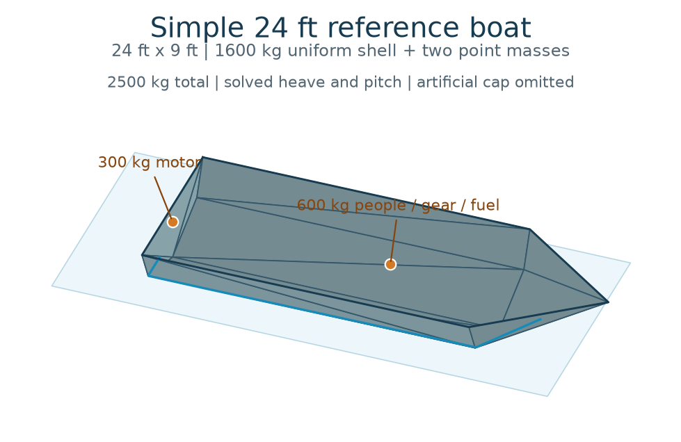

# Topwater

Topwater is developing a time-domain potential-flow solver for a freely drifting
boat with six rigid-body motions and a changing wetted surface.

**Topwater's own fluid-body solver is not validated yet.** The selected
implementation is the existing **P0 Rankine-panel core**, extracted from
`4e8f511`: physical inputs, calm-water hydrostatics, Laplace boundary solves and
instantaneous added mass. It has **no coupled time-domain wave-response path**.
The archived nonlinear diagnostic runtime is a different, unqualified experiment.

The first minimum-mesh Capytaine -> official BEMIO -> WEC-Sim reference is
complete: ten seconds of six-DOF motion from rest, a shared upstream incident
packet and a centered isometric video. The17-panel,0.02s fixed-step result has
independent input/interface/physics/video reviews; temporal and mesh accuracy
remain unestablished. [Reproduction and artifacts](reference/wecsim/README.md).

The accepted stronger buoy-derived reference now has a complete60s trajectory
and incident-water video. The active work packages that physical case into a
reusable NPZ workflow and extends the WEC-Sim output with reconstructed total
water geometry. Surface reconstruction reads the computed motion without
feeding back into dynamics. The total-surface method is a provisional linear
approximation with a disclosed near-hull phase limitation; the complete new
canonical solve/render is being verified.
Native solver implementation remains held. See [the current handoff](docs/checkpoint-handoff.md)
for authorization and [AGENTS.md](AGENTS.md) for startup and expert routing.
The broader [Topwater comparison/runtime goal](docs/time-domain-baseline-goal.md)
remains a later objective. [Issue #30](https://github.com/amosborne/topwater/issues/30)
tracks checkpoints.

## Canonical boat and sea



The single application fixture is a simple **24 ft by 9 ft** open V-hull with
**2,500 kg** total mass: 1,600 kg distributed hull/structure, a 600 kg amidships
point load and a 300 kg stern motor point load. Integration determines its
centre of mass and full inertia tensor. See [the boat definition](docs/reference-boat.md).

The current canonical inputs are [boat.npz](examples/simple-boat/boat.npz) and
[sea.npz](examples/simple-boat/sea.npz): the same physical boat and the actual
46086/2023-12-23T00:40Z spectrum with seed42. One example is one boat/sea pair.
Both are plain numeric archives; [the NPZ contract](docs/npz-format.md) defines
their units, frames and arrays. They do not initialize or qualify native physics.

The intended range is convex 18-30 ft boats, 7-11 ft beam, in ordinary ocean
conditions. Incident wavelengths must be at least twice beam and frequencies
at most 0.6 Hz. Breaking, slamming, flooding and loss of contact are outside the
supported simulation scope. Changing supported boats must require input data
only; the reference mesh is not a solver requirement.

## Current foundation

`HullMesh`, `RigidBody`, `WaveComponents`, `InitialState` and `SimulationInputs`
own validated, immutable NumPy data in SI units. Body axes are bow/port/up;
orientation is an active body-to-world quaternion `(w, x, y, z)`. Position is
world CG, linear velocity is in world axes and angular velocity is in body axes.
Hull faces wind outward from the body. Artificial opening caps carry neither
shell mass nor water pressure.

`topwater.hydrostatics` computes flat-water buoyancy and restoring derivatives.
`topwater.bem` and `topwater.boundary` assemble and solve Laplace problems.
`topwater.inertia.instantaneous_added_mass` computes six instantaneous responses
for a flat zero-potential surface. This is not a finite-frequency wave solver.

## Canonical workflows

All commands take an optional example directory, defaulting to the current
directory. Filenames are fixed:

```powershell
uv run topwater generate-sea examples/simple-boat --record ndbc-46086-20231223T0040Z --seed 42
uv run topwater solve examples/simple-boat 60 --solver=wecsim
uv run topwater render examples/simple-boat
```

Generation writes sea.npz. Solve reads boat.npz/sea.npz and writes the complete
result.npz and six-DOF motion plot result.png; an existing video is left untouched.
Render reads only result.npz,
including its exported hull snapshot, and writes video.mp4 without recomputing
waves. Results permit independently sampled motion and changing surface topology.
Validated data/video outputs are replaced atomically; failures preserve the
previous data. Commands also write consistently formatted `sea.log`, `result.log`
and `video.log`, each describing its latest attempt. Logs are replaced at command
start, including failed attempts. See [logging](docs/cli/logging.md) and
[warning triage](docs/cli/warning-triage.md).
Final result/video binaries use Git LFS. No intermediate solver files belong in
the example directory.

Read each command's inputs, hard-coded choices, errors and warnings:
[generate-sea](docs/cli/generate-sea.md), [solve](docs/cli/solve.md),
[render](docs/cli/render.md). The renderer retains the accepted800square
Matplotlib top-down style. Historical incident-only movies and measurements
remain documented under [the reference workflow](reference/wecsim/README.md).

Native remains the default and reports unavailable. To prepare this machine for
the first WEC-Sim backend, use `uv sync --locked --group wecsim`; MATLABR2025b,
licensed toolboxes and the maintained fork are additional requirements. Current
surface qualification limits are stated on the solve page rather than silently
substituting incident waves.

## Development

```powershell
uv sync --locked
uv run --locked pytest
```

Capytaine supplies coefficients and field reconstruction for the optional
WEC-Sim workflow. It also supplies independent comparison data for native-core
validation:

```powershell
uv sync --locked --group correlation
```

Generic mathematical tests do not establish Capytaine agreement. The frozen
[validation contract](validation/canonical-boat.json), [reset instructions](docs/validation-reset.md)
describe historical validation requirements; current scope is in the handoff.

The later requirement is 0.1 degree in each rotation and 1 cm in each
translation throughout 60 seconds, at no more than 20 wall seconds per simulated
second on the development machine. Real time is preferred. Neither this longer
target nor the first one-second/200x milestone has been demonstrated.

Optimization history is preserved at Git tag `archive/optimization-2026-10-23`.
The retired canoe and historical experimental paths do not qualify this boat.
