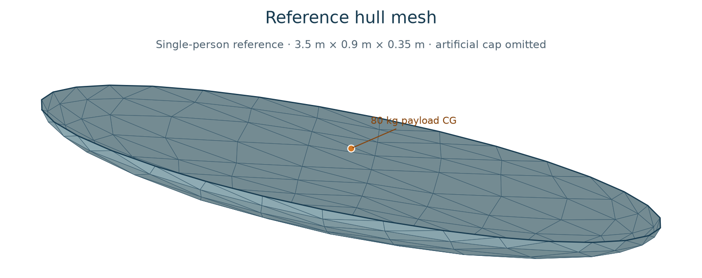

# Topwater

**Nonlinear wave-body dynamics in Python.**

Topwater is a planned open-source, three-dimensional time-domain potential-flow solver for freely floating bodies in directional waves. The initial target is one rigid boat with six free motions, an evolving free surface and changing wetted hull geometry, explicit viscous damping, and an external force and torque interface.

**Status: verified Laplace panel kernels and operator assembly. Boundary solves,
wave evolution and body dynamics are not implemented yet.**

## Approach

Solve incompressible, inviscid, irrotational water flow using boundary elements on the wetted hull and surrounding free surface. Couple pressure and body acceleration consistently, so buoyancy, wave excitation, diffraction, radiation and added-mass effects emerge from the fluid solution rather than being added from fixed coefficient tables.

Use NumPy/SciPy arrays and linear algebra, with a compiled Numba panel kernel.
Existing Capytaine results will supply independent linear benchmarks.

The initial scope is a single rigid body in deep water, with reproducible directional wave realizations and no anchor or mooring forces. Viscous damping remains an explicit model requiring sensitivity analysis or calibration. Breaking/overturning waves, resolved slamming jets, flooding, propulsion and multiple bodies are outside the initial scope. Free yaw does not guarantee a settled heading.

## Reference hull



One canonical single-person canoe supplies the shared geometry and loading for
tests and future Capytaine comparisons. It is an open lower half-ellipsoid,
**3.5 m long, 0.9 m wide and 0.35 m deep**, with its rim at body `z = 0`.
An explicitly marked artificial cap closes the test mesh; the image omits it
to show the opening. That cap is not a watertight deck. The image shows geometry
and the payload's specified CG; no fluid simulation is implemented.
Refinements approximate the same exact surface; they are not different hulls.
The smooth reference does not exercise chines or transoms.

Loading uses round, illustrative inputs: a **3 mm thin shell**, assumed
fiberglass/resin laminate density **1800 kg/m³**, and an **80 kg adult payload**
on the centreline, with its CG **0.1 m above the rim**. The payload is a point
mass with no intrinsic body inertia. Shell loading uses surface area times
thickness and density; the artificial cap has no mass. The model omits shell
through-thickness inertia and separate seat/equipment mass. It is a declared
reference case, not a laminate specification or a model of a manufactured canoe.

Mass, CG and the full inertia tensor about combined CG are integrated from that
loading. Independent surface quadrature supplies the reference; triangle
integration must converge toward it. A scalar root of the exact shape's
displacement sets the initial draft in water of density 1000 kg/m³, placing the
world waterline at `z = 0`. The finite mesh approximates that pose. This is a
shape-specific initialization, not a general hydrostatic or fluid solver.

Future moving-geometry checks must stop at **rim immersion** (flooding onset) or
**complete loss of hull–water contact**, including invalid initial states.
Rim clearance must use the local evolving free surface. An artificial closure
must never hide flooding by supporting deck pressure. These failure detectors
belong to the moving-waterline stage and are not implemented yet.

The definition, generator and analytical reference values live together in
[tests/reference_hull.py](tests/reference_hull.py). Run the geometry checks with
`uv run pytest tests/test_reference_hull.py` and time initial mesh validation
with `uv run python -m tests.benchmark_inputs`. These timings exclude a fluid
solve and do not measure timestep performance.
Regenerate the image with
`uv run --with matplotlib python -m tests.plot_reference_hull`.

## Physical input API

`topwater` currently exposes `HullMesh`, `RigidBody`, `WaveComponents`,
`InitialState` and `SimulationInputs`. Constructors validate inputs and copy
arrays into read-only storage. All values use SI units; no conversion is implicit.
Mesh vertices are contiguous `float64` arrays and triangle indices are contiguous
`int64` arrays. Full validation occurs at construction/import, not during a
time-integration loop. The triangles describe hull geometry; BEM panel order
and unknown placement remain a separate Stage 1 choice.

- World axes are east/north/up; body axes are bow/port/up. Both are right-handed.
- Orientation is an active body-to-world unit quaternion `(w, x, y, z)`.
  `InitialState.position` is the world CG position, linear velocity is in world
  axes, and angular velocity is in body axes. Defaults describe rest at the
  identity pose. Positive rotations follow the right-hand rule.
- Hull vertices are in body coordinates; triangular faces wind outward from
  the body. Supply the complete closed hull, including initially dry geometry.
  `RigidBody.cg` uses those same body coordinates; `inertia_cg` is the symmetric
  positive-definite inertia tensor about CG in body axes, in kg m². Principal
  moments must satisfy the inertia triangle inequality.
- A mesh point transforms as `position + R @ (vertex - cg)`. The helpers
  `body_to_world` and `world_to_body` in `topwater.frames` rotate free vectors;
  they do not translate points. `shift_moment` changes a load's reference point
  with `M_to = M_from + cross(from_point - to_point, F)`, all in one frame.
- Wave amplitudes are in metres, angular frequencies in rad/s, and directions
  and phases in radians. Directions describe **propagation**, counterclockwise
  from east, with phase convention
  `cos(k * (x*cos(direction) + y*sin(direction)) - omega*t + phase)`.
  `propagation_angle_from_bearing` converts a coming-from compass bearing
  (degrees clockwise from north); a wave from north propagates south.
  Empty component arrays mean calm water. Phases, spectral tails, seed and
  string-valued provenance are preserved; a seed does not generate phases.

Mesh validation checks edge closure, connectedness, winding, degeneracy and
positive enclosed volume. It does not detect self-intersections or guarantee
suitability for a moving waterline. Geometry-stage checks will handle those
limits. Body-outward normals are a geometry convention; the numerical contract
defines fluid-domain normals and the pressure gauge separately.

`SimulationInputs.to_json()` and `SimulationInputs.from_json(text)` round-trip
the physical inputs using `format_version: 1` and revalidate on import. For a
small synthetic example, see [the shared reference case](tests/reference_hull.py).
This format contains no numerical controls, evolving fluid state, integrator
state or solver outputs and cannot serve as a restart. It is a development API;
the initial solver scope remains the one-body, zero-forward-speed case above.
The validated frame helpers are boundary conveniences. Future timestep code
should reuse validated arrays and one rotation matrix per pose rather than copy
and revalidate every panel transformation.

## Roadmap

The [numerical contract and verification gates](docs/numerics.md) define the
initial direct Rankine-kernel BEM, sign/gauge conventions, planned accuracy
checks and cost measurements. `TrianglePanels` in `topwater.rankine` caches
flat-panel geometry; `panel_influence` returns the positive Rankine single layer,
principal-value double layer and optional bulk gradients. `assemble_laplace` in
`topwater.bem` fills dense operators directly, with preallocation budget checks,
measured diagnostics and NPZ serialization. Hull fluid normals use
`TrianglePanels.from_mesh(hull, normal_sign=-1)`. The artificial cap is only a
mathematical test boundary, never a physical wetted deck.

Independent quadrature checks self, near and far interactions. Unresolved close
pairs fail explicitly; global panel-intersection detection is not implemented.
The compiled kernel replaces the measured NumPy bottleneck without maintaining
a second production formula. Benchmark assembly with
`uv run --locked python -m tests.benchmark_rankine`, or add `--operation field`
for 128 fixed bulk targets and gradients. Reports record five warm timings,
isolated cold compilation, actual BLAS threads, numerical errors and fresh-process
peak RSS. These are kernel costs, not timestep or Capytaine validation results.

Requirements, implementation stages and acceptance criteria live in [GitHub issues](https://github.com/amosborne/topwater/issues/1). Each stage requires verification evidence and measured execution time before later stages rely on it.

- [ ] [Stage 0: Define solver contracts, physical scope and verification gates](https://github.com/amosborne/topwater/issues/2)
- [ ] [Stage 1: Implement and verify the boundary-element numerical core](https://github.com/amosborne/topwater/issues/3)
- [ ] [Stage 2: Propagate nonlinear directional waves without a boat](https://github.com/amosborne/topwater/issues/4)
- [ ] [Stage 3: Track the moving waterline and instantaneous wetted hull](https://github.com/amosborne/topwater/issues/5)
- [ ] [Stage 4: Recover consistent pressure and verify prescribed-body hydrodynamics](https://github.com/amosborne/topwater/issues/6)
- [ ] [Stage 5: Couple the fluid to six freely moving rigid-body degrees of freedom](https://github.com/amosborne/topwater/issues/7)
- [ ] [Stage 6: Add explicit viscous damping and external force and torque interfaces](https://github.com/amosborne/topwater/issues/8)
- [ ] [Stage 7: Qualify one boat in one observed directional sea state](https://github.com/amosborne/topwater/issues/9)
- [ ] [Stage 8: Profile, optimize and publish a reproducible release](https://github.com/amosborne/topwater/issues/10)

The first end-to-end demonstration will cover one boat and one observed directional sea state. Broader boat catalogs and sea-state populations follow only after the numerical and runtime checks justify them.

## Contributing

Development requires Python 3.12 or newer and uses uv 0.12.10. Install
[uv](https://docs.astral.sh/uv/getting-started/installation/), then run from a clean
checkout:

```sh
uv sync
uv run pytest
```

After changing dependencies in `pyproject.toml`, run `uv lock` and commit `uv.lock`.
CI uses `uv sync --locked` and `uv run --locked pytest` so dependency changes
without an updated lockfile fail.
Tests run on Linux with Python 3.12–3.14 and Windows with Python 3.12.

Build and check local distributions with:

```sh
uv build
uv run python scripts/check_distributions.py
```

Start with an empty `dist/` directory when repeating the packaging check after a
version change. It expects one wheel and one source distribution, installs the
wheel with standard pip in a temporary environment outside the checkout, then
rebuilds and checks the source distribution the same way. These checks need
network access to install dependencies. Generated files remain untracked.
Consumers can install the local wheel with `python -m pip install path/to/topwater.whl`
(using the actual wheel filename). No PyPI release is available yet.

Package metadata and dependency declarations live in `pyproject.toml`; the
PEP 517 build backend can change when compiled kernels become necessary.
Publishing is deferred until Stage 8,
after Stage 7 qualification; development and CI never upload packages.

Start with an open stage issue and discuss changes that affect its physical assumptions or interfaces. Contributions should distinguish numerical verification from physical validation, preserve wave/input provenance, and include timing and convergence evidence appropriate to the change. Do not commit generated simulation output or third-party code without checking its license.

Use focused branches from current `main`, with one pull request per reviewable
change. Pull requests are squash merged onto `main`; start the next branch from
updated `main` after the merge.

## License

[MIT](LICENSE), copyright 2026 Alex Osborne.
