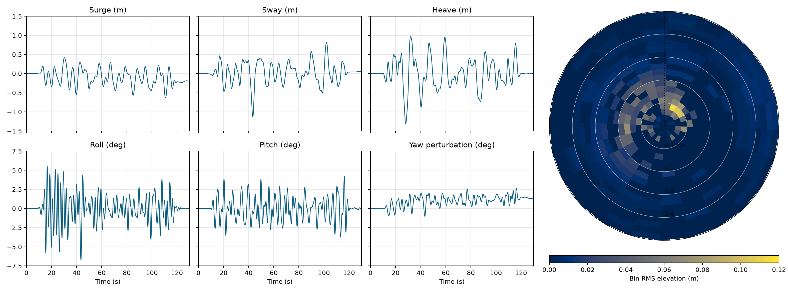

# Topwater

Topwater runs a boat in an observed directional sea using Capytaine and WEC-Sim,
then reconstructs the total water surface and renders the saved result.
Capytaine supplies linear hydrodynamic responses; WEC-Sim computes excitation
and six-degree-of-freedom motion. The unfinished native solver is no longer part
of the active package.

## Quick start

Install the simulation dependencies and start MATLAB as described in
[setup](docs/setup.md). Then run:

```powershell
uv run topwater boat examples/simple-boat --length 7.3152 --beam 2.7432 --deadrise 20 --mass 2500
uv run topwater generate-sea examples/simple-boat --record ndbc-46086-20231223T0040Z --seed 42
uv run topwater solve examples/simple-boat 100 --rest 10 --ramp 5
uv run topwater render examples/simple-boat
```

The example has a 100 s dwell, 5 s ramps and 10 s rests: 130 s total. WEC-Sim
is the sole backend; existing `--solver=wecsim` commands remain accepted.
Rendering an existing result does not require MATLAB or Capytaine.

The [published example](examples/simple-boat/) contains the boat and sea inputs,
motion/surface archive, motion and spectrum plot, video and four command logs.
Its boat is a 24 ft by 9 ft open V-hull with total mass 2,500 kg. The sea is the
NDBC 46086 observation at 2023-12-23 00:40 UTC, realized with seed 42.



## Documentation

- [Setup](docs/setup.md): dependencies, MATLAB and local development.
- [Workflow](docs/workflow.md): boat and sea generation, solve, render and outputs.
- [File formats](docs/formats.md): numeric arrays, units and coordinate frames.
- [Model assumptions](docs/model.md): physical method and practical limitations.

Physical validity is left to user interpretation of the documented assumptions,
limitations and results. There is no automated qualification or CI merge gate.
Old research, native-solver experiments and project bookkeeping are preserved in
committed Git history; the active tree contains the working workflow.
