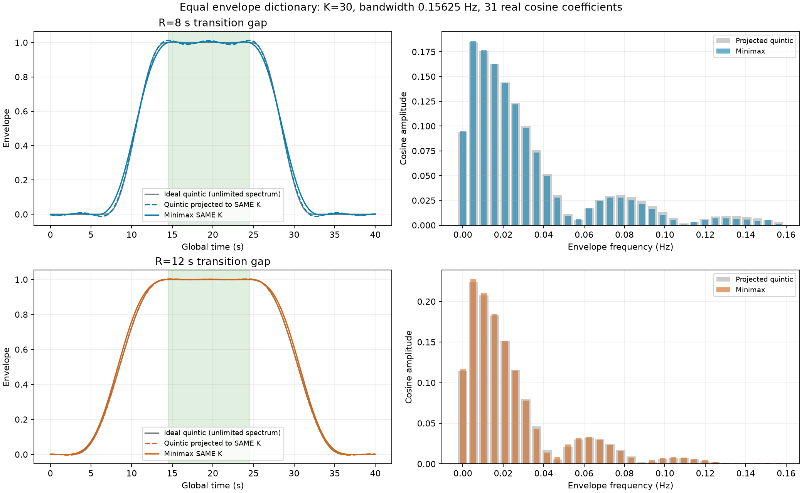
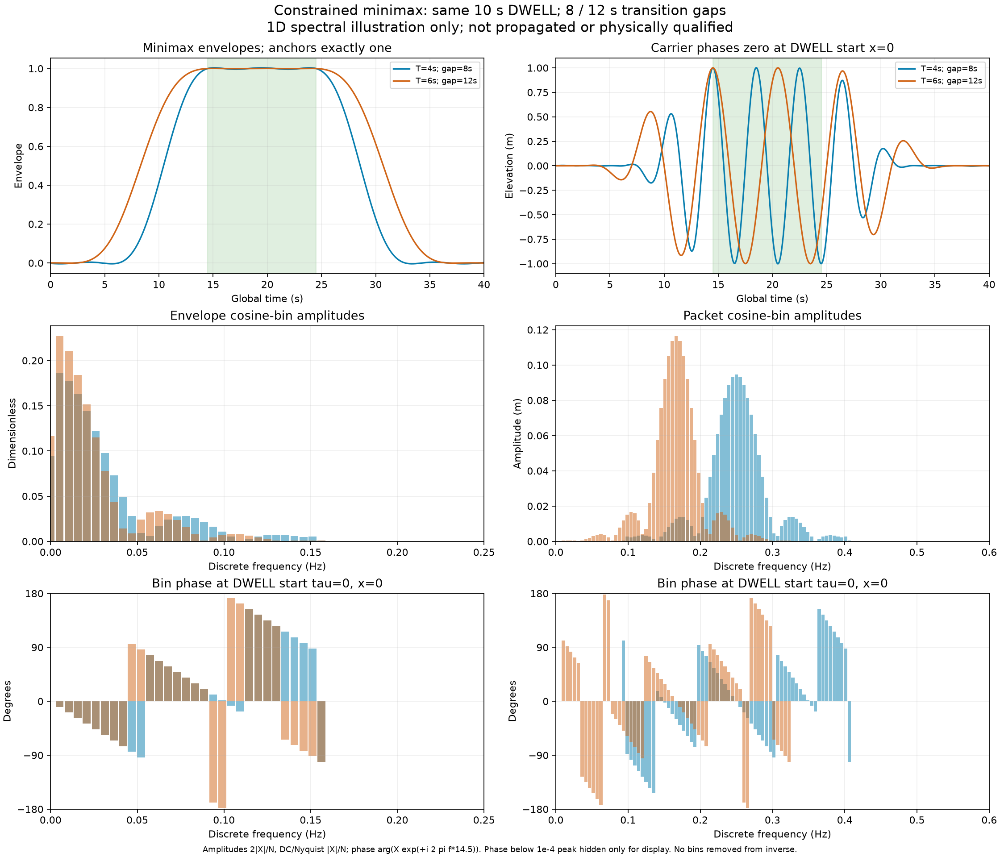

# Minimax versus quintic: equal spectral budget

**Latest user choice:** the current example uses no optimizer, a fixed quintic
and largest-N Fourier selection; see [the N10/20/40 plots](pulse40-three-examples.md).
This older minimax comparison remains preserved under its original policy.

**Latest discussion:** the user proposes0.01–1Hz/.001Hz for sea carriers and
clarifies that each carrier has its own packet construction based on base
frequency and dwell. Packet offsets/spacing are a separate choice; carrier
limits are not automatically final-component bounds. The study below used a
different grid and remains an illustration. Preserve its original results.

**Earlier band discussion:** the previously requested incoming band was
0.05–0.5Hz. This example does not enforce it: the6s carrier withK30 sidebands
reaches0.0104167Hz. Preserve this comparison as originally run. The later
0.01–1Hz proposal admits that lower value, but the old example does not use
the new0.001Hz grid or100sDWELL and is not a qualified production input.

This is the first bounded option1 demonstration for [issue36](https://github.com/amosborne/topwater/issues/36),
not a production waveform generator or propagated wave solution.

Both original carriers have amplitude1m, periods4s/6s, and specified phase0 at
the common dwell start14.5s. Dwell is10s, ending24.5s. Transition gaps are8s/12s,
matching the earlier quintic example.

## Side-by-side comparison

Gray is the ideal quintic with its unlimited spectrum. Dashed is that quintic's
unnormalized projection onto the same finite spectral dictionary as minimax.
Solid is minimax. Only dashed versus solid is an equal-spectral-budget comparison.
The transition shape is free; matching the original polynomial inside it is not
the objective. A small ripple during dwell and quiet time is allowed.

## Time and frequency chart

All spectral plots use discrete bars. Cosine amplitudes are2|X|/N with DC/Nyquist
counted once. Phases refer to dwell start at the observation origin; negligible
phases are hidden only for display. No bins are removed from inverse checks.

## What was optimized

The envelope is real and even about the dwell midpoint19.5s:

`g(u) = c0 + sum(k=1..30) ck*cos(2*pi*k*u/192)`, with `u=t-19.5`.

Both methods use31 real cosine coefficients, equivalent to61 complex envelope
lines, through0.15625Hz. The optimizer minimizes the same worst absolute error
against envelope1 during dwell and envelope0 in the quiet part of the192s
period. It anchors the envelope to1 at both dwell endpoints. Transition
constraints allow small negative ripple and cap sampled overshoot at1.05;
the coefficient L1 norm is limited to10. These are explicit illustration settings,
not adopted physical calm-water/error requirements. No derivative constraints
or quintic target shape are imposed on the optimized transition.

The carrier spectra are shifted copies within the chosen frequency budget.
These two carriers stay at positive frequencies below0.407Hz. The same envelope
cannot automatically be applied to the full actual sea without checking each
absolute shifted frequency and subsequent spatial dispersion.

## Measured envelope errors

Percentages below are relative to unit envelope amplitude, measured over dense
dwell/quiet samples. With a1m carrier,1% envelope error corresponds to an
amplitude-error allowance of10mm; these are not coupled water-surface errors.

| Transition gap | Method | Dwell peak error | Quiet peak amplitude | Between-node allowance |
|---|---|---:|---:|---:|
| 8 s | Minimax | 0.42204% | 0.42208% | 0.10217% |
| 8 s | Projected quintic | 1.2873% | 1.2351% | 0.11304% |
| 12 s | Minimax | 0.057285% | 0.057321% | 0.081711% |
| 12 s | Projected quintic | 0.29726% | 0.3767% | 0.079404% |

The bounded three-solve refinement stopped with small excesses above the LP grid objective on the denser check (8s gap: 5.15e-06, 12s gap: 3.54e-07, unit-envelope scale). The report retains the false dense-convergence flags; the table uses actual measured errors rather than pretending those smaller LP objectives are continuous guarantees. No rerun to chase unnecessary precision was used.

The allowance uses `L*dt/2`, with `L=2*pi*sum(abs(k*ck/192))` and `dt=1/128s`. It bounds error potentially missed between dense nodes. The LP objective is for its sampled constraints; it is not a certificate of continuous/global optimality. The1.05 transition cap is sampled and can differ between nodes by the reported allowance. No shortest-ramp or runtime-saving claim follows.

Even after adding that allowance, minimax peak-error upper bounds are0.5243%
and0.1390%, below the quintic's observed peaks1.2873% and0.3767%. The improvement
therefore does not depend on ignoring the small refinement residuals. Independent
actual-result review accepted this bounded illustrative comparison, while
retaining the convergence and physical-scope limitations.

The complex inverse reconstruction error is 4.44e-16m. The full bounded illustration took 2.641s. HiGHS was limited to one thread and12s per solve, with at most three solves per case. No WEC-Sim/BEM or canonical-case run occurred.

The [executed report](../experts/numerical_methods_researcher/minimax-packet-demo-2026-10-27.json) records solver histories, exact residuals, coefficient bounds and file identities. Original source data and earlier figures remain preserved.
