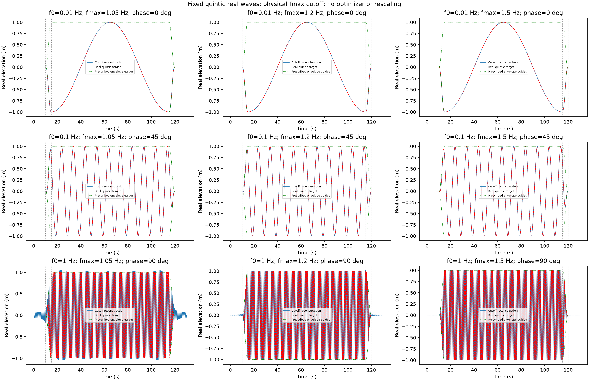
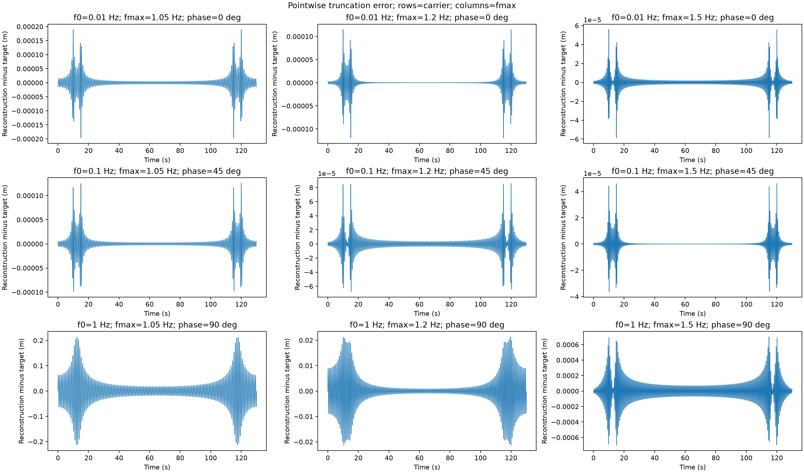

# Fixed quintic packets with a physical frequency cutoff

The target is the ordinary real wave `a(t−65)cos(2πf0(t−65)+phi)`.
Its prescribed envelope has10 s rest,5 s quintic ramp,100 s dwell,5 s ramp down,
and10 s rest. Frequencies .01,.1,1 Hz have respective midpoint phases0°,45°,90°.

Sample that target, take its FFT, keep DC and every signed physical frequency
with `abs(f)<=fmax`, and take the IFFT. Compare fmax1.05,1.20,1.50 Hz for every
carrier. There is no coefficient ranking, optimizer, amplitude normalization or
forced midpoint correction. All positive bins below the cutoff and their
negative conjugates remain. The bin spacing is1/130 Hz; the actual last bin is
`floor(130*fmax)/130`, and the component counts are measured outputs.

The32768-point calculation is compared with65536 points on the same130 s
period: compare retained coefficients and reconstructed curves on common time
samples. Hermitian symmetry, real-valued IFFT, mean preservation and the complete
target FFT/IFFT roundtrip receive numerical identity checks. Peak/RMS, dwell and
quiet errors are reported without a physical pass threshold or continuum-proof
claim. Time and error figures make overlapping accurate curves distinguishable;
discrete amplitude bars show the retained positive components. Green curves are
prescribed envelope guides, rather than a computed analytic envelope.

Source/plan: `artifacts/workflow/pulse-fmax-design1/`. Root owns execution and
publication after independent review. The author ran no numerical jobs. Existing
studies remain under their original policies. The Fourier representation repeats
every130 s; this diagnostic does not promise isolated calm indefinitely.

## Generated plots

Rows:0.01,0.1,1Hz. Columns:fmax1.05,1.20,1.50Hz, giving136,156,195positive
components, respectively, with DC and conjugates retained automatically.

[Discrete spectra](../images/wave-fmax-spectrum.png),
[full metrics](../experts/numerical_methods_researcher/fmax-packets-2026-10-27.json),
[standalone source](fmax_packet_example.py).
This historical comparison used32768/65536points. The newer cutoff-search
utility uses the user's fixed10ms timestep; do not conflate the two grids.
