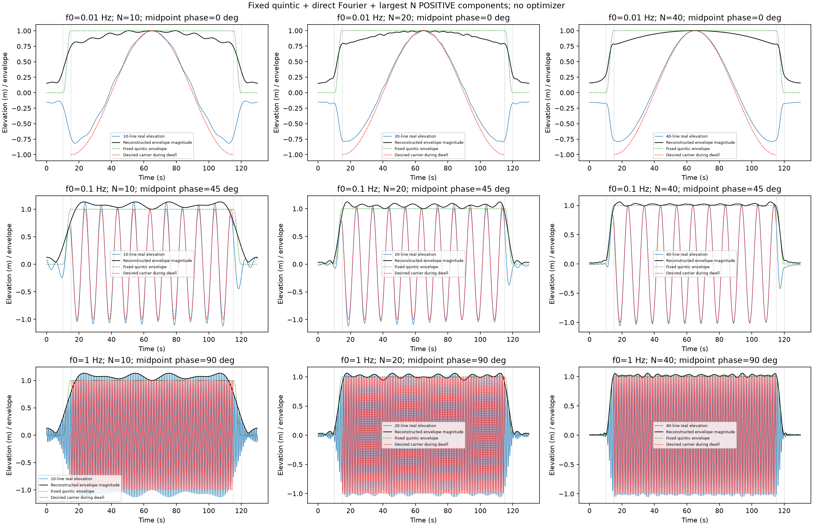
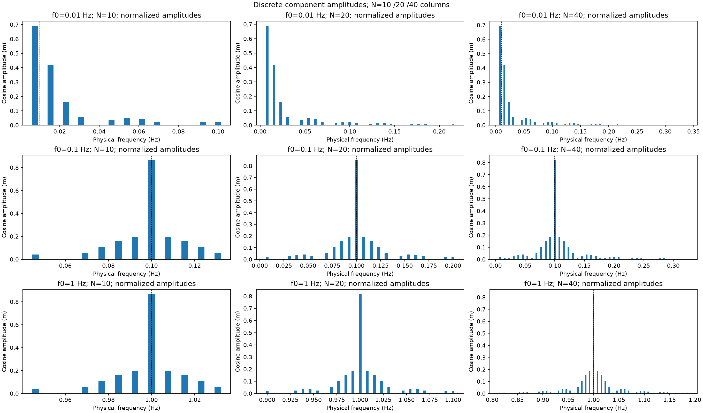

# Quintic packet examples: N=10,20,40

## Generated comparisons

Rows are base frequency0.01/0.1/1Hz, with respective phases0/45/90degrees
defined directly at midpoint65s. Columns are N10/20/40. All cases use exactly
10s rest,5s quintic ramp,100s dwell,5s reversed ramp,10s rest; unit amplitude.

The black trace is reconstructed complex-envelope magnitude, green is the
prescribed quintic envelope, and the dashed red trace is the desired real
carrier during dwell. The blue trace is reconstructed real elevation.
These are distinct quantities; complex-envelope error also measures phase.
The [component-phase comparison](../images/wave-quintic-n-phase.png) uses65s
as its reference directly, with no conversion from dwell-start phase.

| Base frequency (Hz) | N | Dwell complex error | Quiet envelope | Ramp overshoot | Worst score incl. between-node allowance |
|---|---:|---:|---:|---:|---:|
| 0.01 | 10 | 35.53% | 35.2% | 0% | 35.53% |
| 0.01 | 20 | 30.03% | 27.91% | 0% | 30.03% |
| 0.01 | 40 | 29.11% | 27.92% | 0% | 29.11% |
| 0.1 | 10 | 22.03% | 31.53% | 0% | 31.53% |
| 0.1 | 20 | 12.45% | 8.939% | 0% | 12.45% |
| 0.1 | 40 | 7.635% | 6.161% | 0% | 7.635% |
| 1 | 10 | 22.03% | 31.53% | 0% | 31.53% |
| 1 | 20 | 9.684% | 8.242% | 0% | 9.684% |
| 1 | 40 | 5.82% | 3.689% | 3.225% | 5.82% |

All percentages are relative to unit amplitude. These are measured outcomes,
not a physical acceptance test or a minimax optimum. The direct projection
discards analytic-target DC/negative-frequency content, so increasing N does
not remove that separate loss; the report distinguishes it from truncation.
Normalization anchors amplitude/phase at65s and can change peak-error trends.
The actual real-target peak error is also retained in the evidence record.

The nine cases and figures took 6.887s of helper work.
No image inspection was performed; figures are generated for user review.
No production/canonical input, solver or WEC-Sim fork was changed.

The [evidence record](../experts/numerical_methods_researcher/quintic-packets-2026-10-27.json)
contains every retained frequency/coefficient, normalization, raw and final
errors, energy-loss diagnostics and source/terminal identities. The exact
[standalone source](quintic_packet_example.py) reproduces the examples with
`.venv/Scripts/python.exe docs/research/quintic_packet_example.py --output FRESH_DIRECTORY`.
Normal project numerical-execution coordination still applies.

## Construction: fixed quintic, no optimizer, N=10/20/40

Latest user steering supersedes every optimizer proposal below. The new source
and plan are in `artifacts/workflow/pulse40-three-quintic-design1/`. The requested
10 s quiet /5 s ramp /100 s dwell /5 s ramp /10 s quiet profile uses the fixed
quintic `S(x)=10x³−15x⁴+6x⁵`. Carrier frequencies are .01, .1 and1 Hz, with
respective phases0°,45°,90° defined directly at midpoint65 s.

We calculate the prescribed analytic target's Fourier coefficients directly
on positive physical frequencies `j/130 Hz`, retain the largest magnitudes,
and compare nested sets of10,20,40 components. Each set is independently
normalized so its signed coefficient sum equals1 at midpoint; input phase is
then applied directly. No LP, greedy fitting or other optimizer is used.
DC and negative-frequency coefficients are discarded explicitly, without folding;
the resulting projection loss is reported, especially for the .01 Hz carrier.

A third-derivative tail bound determines when the finite candidate search cannot
hide a larger coefficient, subject to reported128/256-point quadrature agreement.
Before normalization, largest-coefficient selection minimizes periodic mean-square
error in this positive-frequency basis. It does not minimize peak error, and
midpoint normalization changes the projection. Peak errors need not decrease
monotonically asN increases. The report gives raw and normalized errors, omitted
energy and coefficient lists. Time, discrete amplitude and phase figures use
rows for carrier frequency and columns forN. No physical accuracy gate applies.
The harmonic construction repeats after130 s; quiet outside the displayed
observation window is not promised. Root owns execution/publication; no job was
executed by the research/source author.

## Historical optimizer proposal (superseded)

Draft diagnostic policy, not a production packet design or physical acceptance.
The requested timing is 10 s quiet, 5 s ramp, 100 s dwell, 5 s ramp, 10 s quiet.
Three independent unit-amplitude carriers have frequencies .01, .1 and 1 Hz,
with respective carrier phases0°,45° and90° defined directly at midpoint t=65 s.
Each may use at most
40 distinct positive physical frequencies. Latest user steering requires a
time-symmetric envelope magnitude. The new symmetric source is in
`artifacts/workflow/pulse40-three-midpoint-design1/`; earlier source paths remain
unchanged as evidence. The prior symmetric/start-reference diagnostic ran under
its old policy; its results are not the new midpoint-phase examples.

The analytic wave is `z(t)=sum(c_j exp(2πi f_j(t−65)))`; physical elevation is
its real part. Its phase-normalized complex envelope is
`g(t)=z(t) exp(−i phi0−2πi f0(t−65))`.
We restrict `g(t)=sum(r_j exp(2πi(f_j−f0)(t−65)))` to real `r_j`.
Consequently `g(65−u)=conj(g(65+u))` and envelope magnitude is even. The
physical coefficients at midpoint are simply `c_j=r_j exp(i phi0)`.
There is no conversion from a start-referenced phase input.
This does not impose paired frequencies or a real-even complex envelope.
The full real waveform is even when its specified carrier phase at midpoint is a
multiple ofπ. The0° example is even, the90° example is odd, and the45° example
is generally neither. All retain symmetric envelope magnitude; waveform
reflection is reported rather than used as an acceptance gate.
We minimize the worst complex error against one throughout dwell and zero
throughout both quiet intervals, together with ramp magnitude overshoot above1.
All three contribute to the same maximum-error objective. This checks phase as well as amplitude.
The exact complex anchor `sum(c_j)=exp(i phi0)` fixes amplitude and phase at
midpoint, implemented as the single real constraint `sum(r_j)=1`.
For fixed selected frequencies, symmetric target intervals and this midpoint
anchor, averaging any complex-coefficient envelope with its conjugate reflection
replaces coefficients by their real parts without worsening the convex max-norm
objective. Thus this real-coefficient symmetry does not sacrifice the attainable
objective within that fixed-frequency formulation. This argument does not apply
unchanged to the previous off-centre exact-anchor policy.

The bounded heuristic selects frequencies from a finite positive dictionary,
then optimizes complex coefficients. Dictionary spacing is 1/260 Hz; its upper
limit `f0+4/R` is an internal search policy, not a user-imposed physical band.
The original carrier is always included. Greedy selection uses half-cosine
ramps as a guide only; the final optimization does not prescribe ramp shape.
The sum of absolute real midpoint coefficients is limited to10 to prevent enormous
cancelling waves. This is40 real amplitude unknowns instead of40 arbitrary
complex amplitudes; it is a substantive restriction. A 16-direction polygon approximates the complex-norm objective;
the final report measures actual complex errors instead of calling the LP
objective the exact answer. Ramp overshoot enters that same objective, with no
separate hard overshoot or accuracy threshold. Initial anchor-normalized
least-squares quality is reported alongside final LP quality; its coefficient
guard feasibility is not assumed.

Dense validation includes every region endpoint. A second-derivative bound
adds `sum(abs(c)*(2π(f−f0))²)*h²/8` to the largest sampled error, using linear
interpolation and the triangle inequality. This is a floating-point engineering
bound rather than interval arithmetic. The report states the resulting continuous
ramp bound and worst objective bound. A failed LP returns the
original carrier as an explicitly marked unoptimized fallback.

Forty positive frequencies mean forty real cosine components, with amplitudes
`abs(c)` and phases `arg(c)` directly at t=65 s. Negative-frequency conjugates required
to represent a real signal are not counted as additional components and are
never folded into the analytic positive-frequency calculation. This distinction
matters especially at .01 Hz, where positive-only localization can perform poorly.

Quality is an output: there is no adopted 1% pass criterion here. The result is
the final LP candidate from this finite heuristic, with its measured change
against initialization reported; it is not guaranteed best among those two
under the dense complex-norm score, and is not a global frequency optimum.
No claim extends beyond0–130 s or to propagation, dispersion,
hydrodynamics or boat motion. Root owns execution and publication; source and
plan are in `artifacts/workflow/pulse40-three-midpoint-design1/`.
