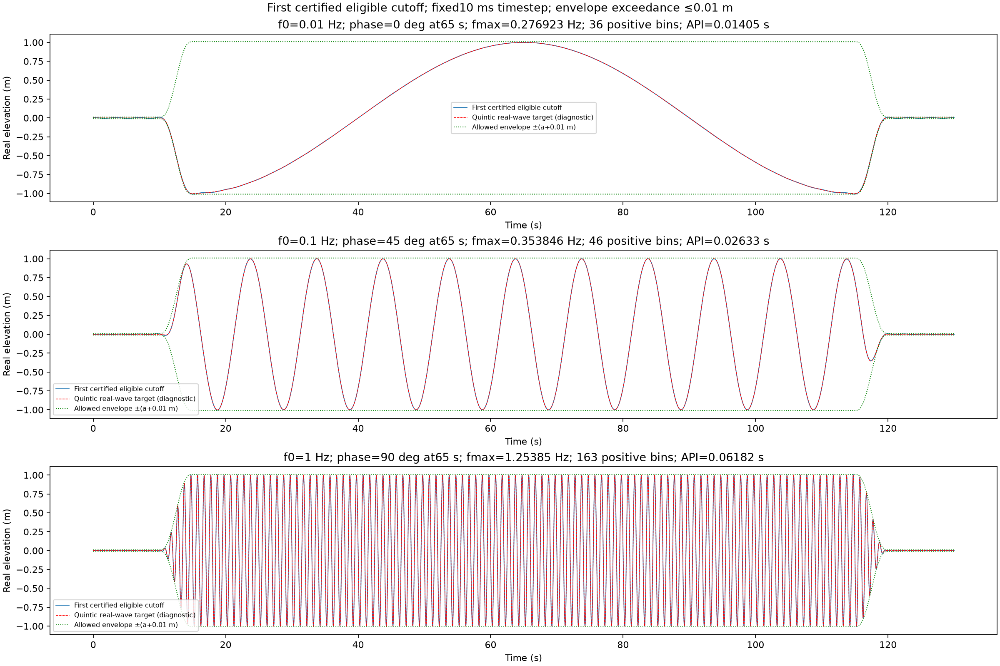

# Quintic packet cutoff search

`topwater.wave_packets` constructs one real, amplitude-scaled temporal packet.
It does not run a fluid/body solver, propagate a wave or modify a sea archive.
The directory solve workflow supplies its timing and original carrier inputs;
`generate-sea` continues to write only the original four carrier arrays.

```python
from topwater.wave_packets import minimum_cutoff_packet

packet = minimum_cutoff_packet(
    frequency_hz=1., phase_rad=0., rest_s=10., ramp_s=5., dwell_s=100.,
    amplitude_m=1., error_tolerance_m=.01,
)
```

Timing is rest, quintic ramp up, dwell, reversed ramp down, rest. The carrier is
`A * envelope(t) * cos(2*pi*f0*(t-midpoint) + phase_rad)`: phase is specified
**directly at the dwell midpoint**, without conversion. The fixed smoothstep is
`10*u**3 - 15*u**4 + 6*u**5`. `quintic_packet` exposes this target separately.

The only quality criterion is absolute envelope exceedance:

`max_t max(0, abs(reconstructed(t)) - A*envelope(t)) <= error_tolerance_m`.

The default tolerance is **0.01 metres**, including both rests, both ramps and
dwell. Ramp undershoot and dwell waveform mismatch are allowed. Dwell error,
ramp/template error and rest residual are reported as diagnostics; none adds a
second acceptance gate. There is no RMS, relative-percent or overshoot-percent
criterion, optimizer, coefficient ranking or amplitude/phase rescaling.

The time step is fixed at **0.01 seconds** (`TIME_STEP_S`), matching the requested
future workflow convention. It does not change current WEC-Sim settings. Each
rest/ramp/dwell duration must align to this step; misaligned values raise
`ValueError` instead of being rounded. The FFT period is the complete requested
window, and frequency spacing is `1/period_s`. A130s window has13000 samples
from0 to129.99s; the exact130s endpoint is also validated. Odd sample counts
are supported, e.g.7.11s gives711 points. There is no public sample-count or
time-step knob, and no time-step adjustment during the cutoff scan.
Cutoffs are contiguous: retain DC, every positive bin up to the cutoff, and its
negative conjugate. The even-grid Nyquist coefficient occurs once. On an odd grid the last positive
coefficient still has its distinct negative conjugate. Positive-bin
count excludes DC and negative conjugates; normalized full complex coefficients
are returned, so `ifft(packet.coefficients * len(packet.elevation_m))` reconstructs the wave.

Eligible cutoffs start at the first physical grid frequency **at or above f0**.
This is an explicit carrier-retention lower bound, not another accuracy test.
All bins below that first eligible cutoff are nevertheless retained. Below-carrier
and DC-only solutions are outside this search. Every eligible cutoff is checked
in order; the algorithm assumes no monotonic relationship between cutoff and
peak error.

One forward FFT is computed. Each step adds one real harmonic to the **entire
fixed validation array**, including exact region-boundary times. It does not
resize a transform or run an IFFT during the scan. Exactly one final IFFT checks the
accepted incremental sum. There is no extra finer-grid transform or alternate
5ms validation grid.

The validation array contains the fixed10ms uniform times plus exact endpoints
of all regions and the full window. Off-grid endpoints use the Fourier series,
not interpolation. To cover times between nodes, the code adds
`(wave_curvature_bound + A*10/(sqrt(3)*ramp_s**2)) * max_gap**2 / 8`.
The wave bound sums `2*abs(C_k)*(2*pi*f_k)**2`, with Nyquist counted once.
Linear interpolation and the triangle inequality justify this guard even at
cusps of the absolute value. A declared floating-point roundoff allowance is also
reported separately. Acceptance uses observed exceedance plus these allowances.

The result is the **first certified eligible grid cutoff under this numerical
bound**, not the exact minimum of the continuous-time problem. Earlier cutoffs
rejected only because of the guard are explicitly counted as unresolved; they
may actually pass. `diagnostics` includes the observed peak/time, certified bound,
both allowances, earlier bounds, carrier start bin and actual sample count/time step.
This establishes the temporal construction within ordinary floating-point
arithmetic, not an interval proof, propagated quiet-water guarantee or model
accuracy claim. The trigonometric reconstruction repeats periodically.

The fixed grid must provide at least64 total samples and16 per carrier period
and per ramp. These are resolution safeguards, not convergence theorems.
Frequency, amplitude and ramp must be positive; rest and dwell must be
nonnegative; all inputs and tolerance must be finite, and tolerance must be
nonnegative. Invalid/misaligned/underresolved inputs, nonfinite spectra, failed
final Fourier identities and failure to certify through Nyquist raise
`ValueError`. Tight tolerances can remain uncertifiable on the fixed grid even
when truncation is small, because the between-sample guard has a nonzero cost.

Root-only validation command: `.venv/Scripts/python.exe -m pytest -q
-p no:cacheprovider tests/test_wave_packets.py`. Tests compare the first certified
cutoff with an independent full-complex FFT/IFFT scan, check DC/conjugates,
endpoint evaluation, direct midpoint phase, absolute tolerance and transform-call
counts. No production sea, CLI, WEC-Sim or native solver integration is included.

## Measured implementation example

For1m waves with rest10/ramp5/dwell100/ramp5/rest10, fixed10ms, midpoint
phases0/45/90degrees and10mm absolute envelope bound:

| BaseHz | Certified cutoffHz | Positive bins | Complete API time(ms) | Certified exceedance bound(mm) |
|---|---:|---:|---:|---:|
| 0.01 | 0.276923 | 36 | 14.05 | 9.9173 |
| 0.1 | 0.353846 | 46 | 26.33 | 8.1251 |
| 1 | 1.25385 | 163 | 61.82 | 9.0022 |

All21 focused tests pass. Timings cover complete API calls, including final
IFFT validation, rather than only the search loop. The guard changes no cutoff
for0.01/0.1Hz and adds one bin for1Hz. This is the first certified cutoff,
not an exact minimum of continuous-time exceedance. Dwell errors are diagnostics.



[Complete coefficient/search history evidence](experts/numerical_methods_researcher/packet-cutoff-search-2026-10-27.json).
Plots were generated for user review without agent image inspection.


## Directory solve timing

`topwater solve [DIRECTORY] DWELL --rest REST --ramp RAMP --solver=wecsim`
uses the positional time for **dwell**, not total simulation length. Defaults
are10s rest and5s ramp on each side. Thus `DWELL=100` means the complete130s
window: rest0?10, ramp10?15, dwell15?115, ramp115?120, rest120?130. Target
carrier phases are specified directly at midpoint65s; zero phase means a target
crest at the solver wave reference point. Changing the dwell changes that
reference time without modifying the original carrier phase values. Sea uses the
standard physical convention `cos(k dot x - omega*(t-midpoint) + phase)`.
This utility uses positive time, so an adapter passes `-Sea.phases_rad` to it
and conjugates its positive-time Fourier coefficients for negative-time wave
synthesis. That sign mapping preserves the original spatial/temporal convention;
it does not shift the requested midpoint reference or rewrite carrier inputs.

The CLI passes dwell/rest/ramp to the backend and records dwell, per-side rest
and ramp, total, midpoint, fixed0.01s time step and phase interpretation in
`result.log`. It rejects nonfinite/nonpositive dwell/ramp, negative rest and
misalignment before entering the backend. `sea.npz` and `boat.npz` remain input
sources; solve does not replace them or add a packet archive to the example.
Duration-dependent construction belongs to the solver workflow, keeping this
constructor usable by a future native backend. The native dynamics backend is
still unavailable. Backend-specific physical/DC/startup assumptions and fatal
checks are documented on the [solve page](cli/solve.md).

The utility tolerance applies to one amplitude-scaled component. The WEC-Sim
workflow allocates its0.01m incident reference-point budget proportionally:
`component_tolerance = 0.01 * component_amplitude / sum(amplitudes)`. Independent
per-component0.01m tolerances would not establish that aggregate budget. Neither
allocation is a1cm body-motion or propagated-surface accuracy claim; spatial
startup/physical checks remain backend responsibilities. Standard outputs remain `result.npz`, `result.png` and
`result.log`; a separate render updates the video and its log.
