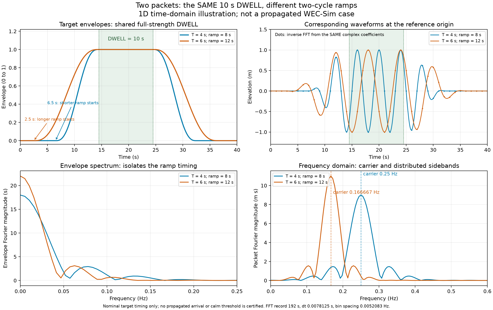

# Wave-packet timing: a 1D construction example

This illustration addresses [issue #36](https://github.com/amosborne/topwater/issues/36):
use ramps measured in wave cycles while giving different packets the **same
full-amplitude dwell**. The requested CLI duration is intended to mean dwell;
the production CLI has not yet been changed.

The example compares two original wave periods, 4 s and 6 s. Each ramp lasts
two periods, giving ramp durations of 8 s and 12 s. Both envelopes reach full
amplitude at 14.5 s, stay there for exactly 10 s, and start falling at 24.5 s.

| Packet | Wave period | Each ramp | Ramp-up interval | Full-amplitude dwell | Ramp-down interval |
|---|---:|---:|---|---|---|
| A | 4 s | 8 s | 6.5–14.5 s | **14.5–24.5 s** | 24.5–32.5 s |
| B | 6 s | 12 s | 2.5–14.5 s | **14.5–24.5 s** | 24.5–36.5 s |

The different ramp lengths extend outward from the common dwell. Thus total
packet lengths are 26 s and 34 s even though both dwells are 10 s. This is one
candidate alignment, rather than an implemented or qualified test policy.

## Construct the envelopes and waves

For each packet, use the same smooth transition

\[
S(u)=10u^3-15u^4+6u^5,\qquad 0\leq u\leq1.
\]

It joins zero to one with zero first and second derivatives at both ends.
Stretch that transition over the packet's ramp duration, hold the envelope at
one during the shared dwell, then reverse the transition during ramp-down.

Multiplying the envelope by its carrier wave gives the target time trace:

\[
\eta_j(t)=A_j E_j(t)\cos\!\left(2\pi t/T_j+\phi_j\right),
\]

with equal amplitudes A_j=1 m and fixed phases phi_j=0 in this illustration.
The envelope, rather than the oscillating height, defines dwell: a zero
crossing during dwell still represents a full-amplitude wave. Phases need not
be adjusted to make the wave end at a zero crossing.

## Read the frequency plots

A finite envelope has a frequency distribution rather than a single spectral
line. Multiplying it by a carrier shifts copies of that distribution to the
carrier frequencies. The resulting fixed complex spectral coefficients encode
both magnitude and phase; summing them reproduces the packet. The plotted
magnitudes alone are insufficient for reconstruction.

The figure separates the envelope spectrum from the wave-packet spectrum so
that ramp effects can be distinguished from the change of carrier frequency.
The inverse transform uses the full complex coefficients and is checked against
the constructed time traces. Padding samples the spectrum more finely; it does
not add physical information or make a finite packet monochromatic.

## What this does not establish

These are target **1D time traces**, not a propagated water solution or a WEC-Sim
run. Actual production packets are constructed upstream in space, decomposed
spectrally and propagated with dispersion. Their observed envelope can change,
and finite spectral support leaves tails. The nominal first ramp beginning at
2.5 s is therefore not a certification of the desired calm-water interval.

Issue #36 must still establish actual threshold crossings over the hull,
multidirectional timing, spectral-support sensitivity, measured boat settling,
and the effect of the physical ending on surface reconstruction. The accepted
quintic joins do not by themselves settle those timing questions.

## Executed numerical checks

The inverse transform reproduces the target traces with maximum error 4.81e-16 m. The time/frequency energy check differs by at most 4.44e-14 m² s. Both envelopes are exactly one over the same sampled 10 s dwell.

The displayed spectra are the positive-frequency half of `dt * abs(rFFT)`, without doubling; the omitted negative half is its complex conjugate. The record is 192 s at 128 samples/s, giving 1/192 Hz frequency-bin spacing. Full complex coefficients, rather than magnitudes alone, are used for the inverse.

See the [executed evidence](experts/numerical_methods_researcher/wave-packet-timing-demo-2026-10-27.json) for parameters, normalization and checks. These checks demonstrate the spectral construction, not physical propagation or boat settling.
